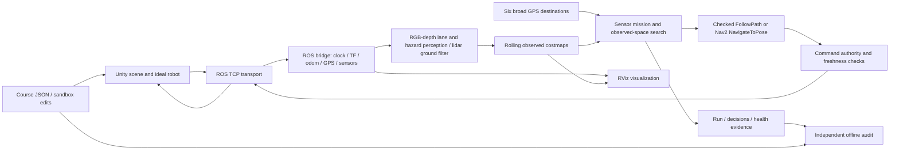

# Claude Code handoff — IGVC Unity / ROS 2 simulator

Prepared **October 1, 2026, America/Los_Angeles**; some evidence directories use
October 2 UTC. This document describes the local working tree, not a published
release. It is the starting packet for continuing development and optimization.

**October 6 continuation:** the external two-instance route-weight comparison
has completed and its failures are preserved. Weight0 passed7/10 full audits;
weight8 passed9/10 planned trials (9/11 recorded attempts including one startup
retry). Weight8 was slower on6/7 mutually audit-passing pairs. No default or
promotion change follows. Both players stopped; the completed report and limits
are in [October 6 evidence](evidence/navigation-2026-10-06.md). T0045 is revising
the isolated offline corridor teacher after C# fixture failures; do not train
or integrate its unaccepted candidate. The overnight heartbeat resumed at the
user's request through October6 10:00AM Pacific. Read the canonical board before
starting work; no concurrent live session or Unity build without its lease.

**October 5 current state:** the reviewed recovery build is frozen at
**d6519e1ee323db0e66fd5953959f07cc56508cc5**. It passed643 combined checks and,
under T0034, three consecutive seed2027 laps:6/6 and all20 audit checks in
332.55s,358.87s and336.91s. Both reviewers verified complete processing-health
coverage, source/input identity and cleanup. All three used zero charged backups.
The new nearer-station recovery behavior remains unexercised live.

T0033 also passed the same2028 course used in development (6/6/all20,382.93s,
zero charged backups). This is a regression result, not untouched validation or
proof of the change's benefit. The original T0031 first2028 failure (1/6,111.67s,
blocked lane-entry target) remains preserved. T0035's first preselected2029 attempt
stopped2/6 after121.43s: perception and clock freshness expired, correctly latching
autonomy off. Both reviewers accepted the failed evidence (12/20 audit;
1209 health passes,7 failures,0 unknown; complete sampling coverage). Upstream
cause remains undetermined. T0036 added reviewed offline open-gap reporting
(b1aada7,36 focused tests passed). T0037 integrated opt-in Unity frame and
connector-warning timing capture as20a18f3:19 Editor checks, Win64 build and
stopped-player off/on smoke passed. T0038's diagnostic2029 repeat completed6/6
in355.48s with all20 audit checks and3556/0/0 health samples. Same19 policy files,
profile and inputs; tracing enabled in the new player. Both reviewers accepted
this non-reproduction result.379 timing records showed a0.05776s maximum sampled
Update gap and95 startup warning lines; missing terminal record leaves final
coverage unknown. Warning counts are not drops. The original failure remains
unresolved and this pass does not replace qualification.
T0039 added the reviewed offline `tools/diagnose_transport_timing.py` report
(7947325;18 native Windows tests passed, real-log hashes independently checked).
T0040 completed both diagnostic repeats (6/6/all20 in368.40s and349.60s);
no freshness failure reproduced. One checked0.6m backup in the first, none in the
second; nearer-station search still unexercised. Sonnet and qualified Sol reviews complete; coordinator separately verified raw
timing/input/runtime identities. Overnight heartbeat remains paused; user resumed
interactive multi-agent work. T0041 narrowed the next diagnostic change; T0042
integrated sampled connection-error counts and independent FixedUpdate timing
(source 6792e01, schema v3). The analyzer still reads v2 and marks new metrics
unavailable for old logs. Reviews caught and corrected two impossible-record
validation cases and an unrealistic synthetic fixture; original evidence remains.
Unity compilation, 29 Editor checks, a Win64 build, 25 integrated Python tests,
and stopped-player off/on smoke tests passed. The new player assembly is
809c280c1bbe9606e23a4cbbd8d5c7f04a2a63e2070d67622149867e06109dbf.
Smoke testing deliberately had no ROS endpoint: it validates capture behavior,
not a course lap or transport reliability. No simulator is running and no new
runtime fix is claimed. The prior cf8f timing player remains preserved in the
frozen runtime checkout. See the [T0042 packet](agents/tasks/T-0042-sampled-transport-capture.md)
for exact evidence and review limits before granting another diagnostic lap.
2030 was preselected before that outcome and remains ungenerated and untested.
Promotion is blocked, with no retry-selected pass or relaxed freshness limits.
Return margins are narrow; no causal speed gain,
calibrated hardware autonomy or2027 rule compliance is claimed.

Runtime uses only observations and six sanitized broad GPS goals. Recovery can
select a nearer clear station in the same observed corridor, with a nominal
forward bound and unchanged body/unknown/path acceptance. Replacement-path
fallback remains off: its earlier enabled trial failed2/6. Failed-search diagnostics
and deferred capture are integrated but their failure branch remains unexercised
live. Every earlier failure stays in the ledger and detailed evidence.

Opus owns complete bounded development tasks under ADR-011, with independent
Sonnet/Sol reviews and exclusive live-test coordination retained. Current immutable
source, trial grants and outcomes live in the canonical task board; older workspace
and session descriptions below are historical.
See [current evidence](evidence/navigation-2026-10-05.md), the
[task board](agents/BOARD.md) and [research implementation status](agents/COMPETITION_CONTEXT.md#implementation-status-october-5).
Use the [Open Knowledge index](knowledge/index.md) for targeted context and
[its maintenance workflow](OPEN_KNOWLEDGE.md) for source freshness and sharing.
The October 1 checkout/session descriptions below are historical; use the
[task board](agents/BOARD.md) and current Git/runtime state for ongoing work.

## Contents

1. [Start in Claude Code](#start-in-claude-code)
2. [Mission and constraints](#mission-and-constraints)
3. [Current state and evidence](#current-state-and-evidence)
4. [Architecture](#architecture)
5. [Project and source index](#project-and-source-index)
6. [Run, rebuild and test](#run-rebuild-and-test)
7. [Parameters and experiment controls](#parameters-and-experiment-controls)
8. [Prioritized optimization work](#prioritized-optimization-work)
9. [Experiment and acceptance workflow](#experiment-and-acceptance-workflow)
10. [Delegation and handback](#delegation-and-handback)
11. [Known uncertainties and operational pitfalls](#known-uncertainties-and-operational-pitfalls)

## Start in Claude Code

On this Windows computer, Claude CLI is installed at
`C:\Users\brand\.local\bin\claude.exe`. Start a new session in PowerShell:

```powershell
Set-Location 'C:\Users\brand\Documents\ChatGPT\IGVC SIM'
claude
```

If PATH does not resolve it, use `& "$env:USERPROFILE\.local\bin\claude.exe"`.
The root [CLAUDE.md](../CLAUDE.md) points to this packet and the common project
instructions. This follows Claude Code's [project-memory convention](https://code.claude.com/docs/en/memory);
the [CLI reference](https://code.claude.com/docs/en/cli-reference) documents interactive startup.
This handoff does not start an agent or change authentication/model permissions.

Paste this initial task:

```text
Continue this IGVC simulation project. Read AGENTS.md, README.md and
docs/CLAUDE_HANDOFF.md first, then inspect the current Git changes and live
session state. Preserve existing work and any running session. Begin with the
priority-1 processing-health investigation and a reproducible baseline plan.
Use the latest saved sandbox run and independent audit. Do not weaken safety
or audit checks, use hidden course knowledge, or equate 6/6 progress with an
accepted run. Make bounded, measured improvements and report what changed,
what was tested, source/evidence identities and unresolved risks. Delegate
independent scoped work when useful, with one owner per file and one live
simulator at a time. Do not push or publish as part of this handoff.
```

Read this packet once, then use focused source/document reads. Historical review
launchers contain dated assignments and are not an instruction to rerun them.

## Mission and constraints

The goal is reliable, fast **IGVC 2027 AutoNav** in a Unity practice course:
follow white lanes, avoid colored barrels/barricades/potholes, cross a marked
ramp, navigate unmarked approaches, and return by completing the full loop.
The robot must handle its first encounter with a layout using sensors. Broad
GPS destinations communicate intent; they must not become a dense secret route.

User preferences: readable in-simulator controls; terminal operation; Unity and
RViz together; efficient progress through independent agents; fewer repeated
backups; steady forward motion where clearance permits. Reversing is allowed
when a checked maneuver produces useful escape clearance. Do not replace it
with arbitrary turning around, a shortcut home, or repeated blind nudges.

Preserve these invariants:

- **Front = big driven wheels; rear = casters.** ROS +X points forward. The source
  CAD/URDF frame was reversed; description preparation corrects it by Z pi and
  maps physical left/right names. `base_footprint` is at the driven axle;
  `base_link` is 0.25591 m behind it.
- RPLIDAR A1 sits in the **front roof housing**. OAK-D Pro sits atop the **rear
  pole**, with pitch-only tilt; +Y pitch is positive down. Mount JSON files are
  authoritative. Keep originals external and unchanged.
- Current motion, odometry, GPS and sensors are idealized. Do not claim calibrated
  hardware dynamics, real GNSS localization, real stereo matching or deployment readiness.
- Autonomy may consume observations and sanitized `autonomy.json`, not generated
  centerlines, obstacle coordinates, ideal route checkpoints or ramp coordinates.
  `course.json` is Unity's world input and the independent auditor's input.
- Whole-body footprint is approximately x=[-1.1,0.6], y=[-0.5,0.5] m about the
  axle; configured padding adds 0.02 m. Inflation radius is a cost preference,
  not permission to shrink this footprint or bypass hard collision checks.
- The pinned [2027 rules profile](IGVC_2027_PROFILE.md) records **5 mph = 2.2352 m/s**,
  not 5 m/s. The project ceiling is 2.2 m/s; tested successful navigation requested
  0.6 m/s. It also records a 360 s competition budget. Development trials allow
  600 s; neither successful geometry nor that timeout proves competition compliance.

## Current state and evidence

Repository: [PixelPepper/igvc-unity-sim](https://github.com/PixelPepper/igvc-unity-sim).
At preparation, branch was `codex/transport-probe`, HEAD `01709fe`
(`Improve sensor-led navigation and add master project guides`). Many subsequent
changes are **modified/untracked locally**, including navigation improvements,
sandbox source and evidence. Re-run `git status --short` and `git diff --stat`.
Do not assume HEAD, GitHub or a fresh worktree contains this working version.

| Evidence | Result and meaning |
| --- | --- |
| [Preserved accepted trial](evidence/navigation-2026-10-01.md#completed-sensor-led-loop) | Seed 2027 normal; RPP + checked path; 6/6 in 363.37 s armed-through-cleanup; all 20 independent checks passed; one checked 0.6 m backup; return distance 0.3952 m against 0.4 m bound |
| [Preserved audit](evidence/navigation-2026-10-01-success/audit.json) and [profile](evidence/navigation-2026-10-01-success/profile.yaml) | Best fully audited baseline, not a multi-seed reliability result or a demonstrated sub-360 s competition run |
| [Sandbox validation](SANDBOX.md#validation--october-1-2026) | Separate Windows build; large UI; obstacle edits/undo/presets/cutout rollback; 14 offline checks; short RPP and MPPI parameter/start/move/stop trials |
| Latest user sandbox lap, `20261002T035715-45c98a0f` | Reached 6/6 in 376.124 s, one 0.609 m actual backup; all geometric checks passed; **aggregate audit did not pass** because processing-health samples failed |

Latest lap local evidence lives in
`artifacts/sandbox/runs/20261002T035715-45c98a0f/`: `run.json`,
`handoff-audit.json`, `profile.yaml`, `provenance.json`, `course.json`,
`autonomy.json`, `mission.log` and `decisions/`.
A compact [handoff audit copy](evidence/sandbox-2026-10-01/handoff-audit.json)
and [health summary](evidence/sandbox-2026-10-01/handoff-health.json) are preserved
with the documentation; the full artifacts are ignored by Git.

That latest lap had 3,764 valid health samples: **3,760 pass, 4 fail, 0 unknown**.
Coverage was complete; maximum interval gap was 0.11976 s against 0.25 s.
Failures were `lanes:processing_health_false` (4) and
`depth_processing:processing_health_false` (2; reasons can share a sample).
First failing odometry timestamp: 319.96 s. This is a processing-health failure,
not missing sampling coverage. Return distance was 0.39871 m. WSLg/RViz recovery
occurred during this run; investigate timing correlation, but do not assert causation.

At handoff the sandbox supervisor remained open with status `completed`, 6/6,
editable=true. **This is a timestamped observation, not permission to take its
port or stop it.** The GUI may still own the lease, ROS domain and bridge.

## Architecture



Unity renders synthetic RGB and metric depth and simulates lidar. ROS perception
projects observed paint/hazards/obstacles, filters ramp/ground returns, and
publishes costmap inputs. Both costmaps roll in `odom`; “global” is a larger
observed window, not a preloaded course map. Odometry/GPS fidelity is idealized.

`sensor_course.py` uses observed corridor candidates, bounded memory and sparse
destination direction to select local goals. `sensor_route_policy.py` searches
with full-body checks and usable-continuation admission. Checked-path mode sends
the accepted path to Nav2 FollowPath; Nav2-goal mode lets Nav2 plan to its selected
local target. Nav2 output goes through the project's command authority before
Unity receives motion commands. Stale processing, stop conditions and recovery
budgets remain independent of soft optimization weights.

Sandbox UI writes a validated command/settings file. Its Python supervisor owns
Nav2 restart, mission execution, heartbeat and cleanup. Geometry editing is
allowed only while confirmed stopped. Presets include course and settings;
starting a trial resets pose and observations. Course copies saved beside runs
are provenance/audit inputs, not navigation guidance.

## Project and source index

Use the [Master Project Guide](PROJECT_GUIDE.md) and [complete linked file index](FILE_INDEX.md)
for broader coverage. The following are the main optimization entry points.

### Navigation and acceptance

| File | Responsibility / reason to inspect |
| --- | --- |
| [sensor_course.py](../tools/sensor_course.py) | Mission loop, observations, action lifecycle, planner subprocess, recovery and reports |
| [observed_navigation.py](../tools/observed_navigation.py) | Guidance evaluation, refinement and planning orchestration; actual guidance filename |
| [sensor_route_policy.py](../tools/sensor_route_policy.py) | Full-footprint observed-space search, clearance ranking and endpoint admission |
| [lane_corridor_policy.py](../tools/lane_corridor_policy.py) | Extract/rank corridor candidates from observed lane points |
| [entrance_memory.py](../tools/entrance_memory.py), [entrance_support.py](../tools/entrance_support.py), [lane_heading_memory.py](../tools/lane_heading_memory.py) | Bounded remembered entrance/heading and fresh support; distinguish optional modes |
| [path_entry.py](../tools/path_entry.py), [execution_path.py](../tools/execution_path.py) | Admit executable forward connectors and controller paths |
| [recovery_policy.py](../tools/recovery_policy.py), [recovery_budget.py](../tools/recovery_budget.py), [recovery_intent.py](../tools/recovery_intent.py) | Checked backing distance, attempt budgets and meaningful escape intent |
| [swept_footprint.py](../tools/swept_footprint.py) | Whole-body swept geometry checks |
| [action_cancellation.py](../tools/action_cancellation.py) | Wait for confirmed action cancellation |
| [mission_health.py](../tools/mission_health.py), [sensor_telemetry.py](../tools/sensor_telemetry.py) | Armed-interval health ledger and received processing evidence |
| [audit_sensor_run.py](../tools/audit_sensor_run.py), [course_judge.py](../tools/course_judge.py) | Independent acceptance; do not weaken to promote a candidate |
| [navigation_decisions.py](../tools/navigation_decisions.py), [replay_navigation_decision.py](../tools/replay_navigation_decision.py) | Save and replay exact observed planner inputs without Unity |
| [record_navigation_episode.py](../tools/record_navigation_episode.py), [analyze_navigation_episode.py](../tools/analyze_navigation_episode.py) | Bounded synchronized evidence and failure analysis |

### ROS, perception and configuration

| Source | Responsibility |
| --- | --- |
| [igvc_perception](../ros2/src/igvc_perception/) | `lane_node.py` and `depth_node.py`: pairing, projection, health; `point_memory.py`: retained evidence; `scan_ground_node.py`: ramp/ground filtering; `surface_projection.py` and terrain helpers: geometric projection |
| [igvc_lane_layer](../ros2/src/igvc_lane_layer/) | C++ observed point layers for lanes, hazards and depth obstacles |
| [local_navigation.yaml](../ros2/src/igvc_navigation/config/local_navigation.yaml) | Ordinary Nav2 parameters; not the exact accepted RPP baseline |
| [navigation launch](../ros2/src/igvc_navigation/launch/local_navigation.launch.py) | Node lifecycle, parameter loading, topic remaps and patched-controller checks |
| [igvc_sim_bridge](../ros2/src/igvc_sim_bridge/) | Command arbitration/watchdogs, robot state, simulation message contract and RViz configurations |
| [igvc_gps](../ros2/src/igvc_gps/) | Synthetic GPS conversion |
| [igvc_description](../ros2/src/igvc_description/) | Canonical robot description, meshes and sensor mount JSON configs |
| [ROS parameter guide](guide/ROS_PARAMETERS.md) | Exact names/units; read live parameters to establish what actually loaded |
| [ROS interface](ROS_INTERFACE.md) | Topic/frame contracts; distinguish implemented items from planned ones |

### Unity, courses and sandbox

| Source | Responsibility |
| --- | --- |
| [TransportProbe.cs](../unity/IGVCSim/Assets/IGVC/Runtime/TransportProbe.cs) | Transport, sensor setup, active course, sandbox hold/reload |
| [CourseVariant.cs](../unity/IGVCSim/Assets/IGVC/Runtime/CourseVariant.cs) | Course objects/materials, staged rebuild and resource cleanup |
| [CourseRamp.cs](../unity/IGVCSim/Assets/IGVC/Runtime/CourseRamp.cs), [TerrainSupport.cs](../unity/IGVCSim/Assets/IGVC/Runtime/TerrainSupport.cs), [CasterTerrainSupport.cs](../unity/IGVCSim/Assets/IGVC/Runtime/CasterTerrainSupport.cs) | Ramp and wheel/caster support geometry; retain repaired pothole-rim support |
| [R3aKinematics.cs](../unity/IGVCSim/Assets/IGVC/Runtime/R3aKinematics.cs), [ProbeMotion.cs](../unity/IGVCSim/Assets/IGVC/Runtime/ProbeMotion.cs) | Ideal drive motion and local stop behavior |
| [ProbeCamera.cs](../unity/IGVCSim/Assets/IGVC/Runtime/ProbeCamera.cs), [ProbeDepthCamera.cs](../unity/IGVCSim/Assets/IGVC/Runtime/ProbeDepthCamera.cs) | Rendered sensor streams |
| [LaneBoundaryGuard.cs](../unity/IGVCSim/Assets/IGVC/Runtime/LaneBoundaryGuard.cs) | Scoring/guard geometry; sensor-led acceptance uses scoring, not hidden lane blocking |
| [SpectatorCamera.cs](../unity/IGVCSim/Assets/IGVC/Runtime/SpectatorCamera.cs) | Orbit/zoom/follow; keep spectator input separate from sensor camera |
| [SandboxPanel.cs](../unity/IGVCSim/Assets/IGVC/Runtime/SandboxPanel.cs), [SandboxDocument.cs](../unity/IGVCSim/Assets/IGVC/Runtime/SandboxDocument.cs) | Runtime editor, validation, undo, presets and command/status handshake |
| [SandboxPanel.uxml](../unity/IGVCSim/Assets/Resources/SandboxPanel.uxml), [USS](../unity/IGVCSim/Assets/Resources/SandboxPanel.uss), [theme](../unity/IGVCSim/Assets/Resources/SandboxTheme.tss) | Large UI Toolkit controls and layout |
| [Editor builders](../unity/IGVCSim/Assets/IGVC/Editor/) | Reproducible scenes/player builds, including `SandboxBuild.cs`; edit builder source rather than only generated scenes |
| [generate_course_variant.py](../tools/generate_course_variant.py) | Seeded lanes, ramp, colored barrels, barricades, potholes and separate world/autonomy exports |
| [sandbox_profile.py](../tools/sandbox_profile.py), [sandbox_session.py](../tools/sandbox_session.py) | Allowlisted settings, profiles, Start/Stop/heartbeat and saved trials |
| [sandbox.ps1](../tools/sandbox.ps1), [sandbox guide](SANDBOX.md) | Separate player, launch/build/shortcut, controls and test limits |
| [Reference Lab](REFERENCE_LAB.md), [Reference source](../unity/IGVCSim/Assets/IGVC/Runtime/Reference/), [checks harness](../tools/reference_lab/) | Audit-only HPA*/JPS planner, racing-line lap-time bound and AI-driver ghosts from WORLD geometry; never an autonomy input |

### Operations, packaging and background reading

| Entry | Purpose |
| --- | --- |
| [RUNBOOK](RUNBOOK.md), [native AutoNav](NATIVE_AUTONAV.md) | Commands and launch ownership |
| [latest-run.ps1](../tools/latest-run.ps1), [latest_run_viewer.py](../tools/latest_run_viewer.py) | Visible accepted-profile reproduction and audit |
| [igvc.ps1](../tools/igvc.ps1), [ros_session.py](../tools/ros_session.py) | Native player/ROS lifecycle; stop only owned sessions |
| [ros_env.sh](../tools/ros_env.sh), [build_ros.sh](../tools/build_ros.sh) | ROS environment and installed overlay generation |
| [Dockerfile](../docker/Dockerfile), [compose.yaml](../compose.yaml), [Linux overlay](../compose.linux.yaml) | Ubuntu/Jazzy container packaging and display/network boundaries |
| [docker.ps1](../tools/docker.ps1), [docker.sh](../tools/docker.sh) | Windows/Linux container workflows; Unity remains a host process |
| [PLAN](PLAN.md), [SENSOR_AUTONOMY](SENSOR_AUTONOMY.md) | Phase gates and sensor-led design |
| [NAVIGATION_INVESTIGATION](NAVIGATION_INVESTIGATION.md), [RELIABILITY_MILESTONE](RELIABILITY_MILESTONE.md) | Failure history and provenance before the accepted loop |
| [SOONER_COMPARISON](SOONER_COMPARISON.md), [THIRD_PARTY_ASSETS](../THIRD_PARTY_ASSETS.md) | Actual reference-code/asset reuse and licensing boundary |
| [AGENT_ITERATION](AGENT_ITERATION.md), [agent tools](../tools/agents/README.md) | Independent worktrees/overlays, exclusive trials and historical provider tools |
| [Agent hub](agents/README.md): [board](agents/BOARD.md), [protocol](agents/PROTOCOL.md), [git](agents/GIT_WORKFLOW.md), [competition context](agents/COMPETITION_CONTEXT.md) | Current multi-agent roles (ASTRA orchestrates, Opus implements, Sonnet/Sol review), task files and message log, 2026 top-team lessons mapped to this repo |

## Run, rebuild and test

Use PowerShell from the repository root; the Windows path contains spaces.
Unity version is **6000.3.23f1**; ROS is **Jazzy / Ubuntu-24.04** in WSL2.
Native workspace defaults to `/home/brand/igvc_ws`; the patched Nav2 overlay is
normally `~/igvc_nav2_overlay`. Respect `IGVC_ROS_WORKSPACE` and domain overrides.

Read-only preflight:

```powershell
git status --short
git diff --stat
powershell -NoProfile -ExecutionPolicy Bypass -File tools/igvc.ps1 status
Get-Content artifacts/sandbox/status.json -ErrorAction SilentlyContinue
wsl -d Ubuntu-24.04 -- bash -c 'ss -H -ltnp sport = :10000'
```

Default domain is 42, bridge TCP10000. `artifacts/iterations/live.lock` serializes
trial ownership; session metadata is in `artifacts/session/`. A file existing
does not prove that its lease is held: inspect owning processes and identity.
PID values in old logs are not reusable commands. Do not delete locks to force access.

When no other session owns the runtime:

```powershell
# Interactive obstacle/parameter editing, Unity + native WSL RViz
powershell -NoProfile -ExecutionPolicy Bypass -File tools/sandbox.ps1

# Reproduce the accepted profile visibly; Enter in its console starts a lap
powershell -NoProfile -ExecutionPolicy Bypass -File tools/latest-run.ps1

# Rebuild the separate sandbox after Unity source/UI changes
powershell -NoProfile -ExecutionPolicy Bypass -File tools/sandbox.ps1 build

# Rebuild ordinary course player after Unity runtime changes
powershell -NoProfile -ExecutionPolicy Bypass -File tools/igvc.ps1 course-build

# Rebuild native ROS packages after package source changes
wsl -d Ubuntu-24.04 -- bash tools/build_ros.sh
```

Close the sandbox window to let its supervisor shut down. Use the latest-run
console's normal exit path. `tools/igvc.ps1 stop` is recovery for this workspace's
owned native processes; do not invoke it indiscriminately while another agent is
testing. Docker and native ROS must not compete for the bridge. Docker instructions
are in README; latest sandbox/native changes have not established container parity.

Focused offline tests (do not launch Unity or command motion):

```powershell
wsl -d Ubuntu-24.04 -- bash tools/run_ros.sh python3 -m unittest discover -s tools/tests -p test_sensor_route_policy.py
wsl -d Ubuntu-24.04 -- bash tools/run_ros.sh python3 -m unittest discover -s tools/tests -p test_mission_health.py
wsl -d Ubuntu-24.04 -- python3 -m unittest discover -s tools/tests -p test_sandbox_profile.py
# Broader relevant integration check after a combined change:
wsl -d Ubuntu-24.04 -- bash tools/check_core.sh
```

For exact-input replay, choose an existing decision snapshot and run
`tools/replay_navigation_decision.py --snapshot <snapshot.json.gz> --output <new.json>`
through `tools/run_ros.sh`. Keep outputs separate. Wall-limited searches can differ
by hardware/load, and replay does not reproduce controller execution.

Read-only audit recipe for the latest saved sandbox lap:

```powershell
$run='artifacts/sandbox/runs/20261002T035715-45c98a0f'
wsl -d Ubuntu-24.04 -- bash tools/run_ros.sh python3 tools/audit_sensor_run.py --run "$run/run.json" --course "$run/course.json" --mission "$run/autonomy.json" --output "$run/claude-audit.json"
```

Expected result for those frozen inputs: exit 1, geometric full loop true,
aggregate `passed=false`, processing-health interval false. That is evidence,
not a reason to loosen the auditor.

## Parameters and experiment controls

Use the exact [accepted profile](evidence/navigation-2026-10-01-success/profile.yaml)
as the baseline. These explicit mission options accompanied it:

```text
--timeout 600 --speed 0.6 --planning-budget 0.5
--path-execution checked-path --body-clearance-weight 3
```

Ordinary `course` and raw script defaults differ. Never infer the active profile
from a YAML file alone: preserve the generated profile and query live services.

| Parameter/control | Baseline | Where to change / caution |
| --- | --- | --- |
| Controller | RPP | Sandbox chooses RPP or MPPI; their baseline YAML files differ |
| Path execution | checked-path | Mission CLI / sandbox; Nav2-goal is a distinct planning experiment |
| Requested speed | 0.6 m/s | Mission CLI + controller; sandbox allows 0.1–2.2; higher speeds need trials |
| Inflation | 0.30 m | Both costmaps; sandbox range 0.1–1.5; MPPI patch still mandatory |
| Body clearance preference | 3 | Observed search soft weight, not footprint size; sandbox 0–10 |
| Planning budget | 0.5 s | Custom search, not Nav2 planner timeout; sandbox 0.1–5 s |
| RPP lookahead | 0.65 m | Controller; sandbox 0.2–2; not an MPPI setting |
| Observed grids | 0.05 m cells | Current global/local match; memory/CPU cost grows with resolution |
| Camera pitch / lidar pose | Mount config values | Description package JSON; rebuild consumers, don't guess from images |
| Obstacles | Seed 2027 normal | Generator or sandbox presets; changed geometry needs its own audit input |

The sandbox is a runtime menu in a separate built Unity player, not a complete
Unity Editor authoring extension. It edits obstacles, not lane/ramp topology or
the six GPS destinations. Editing settings takes effect on the next Start via
managed Nav2 restart. New algorithms still require implementation and tests;
the menu selects existing algorithms, not arbitrary user scripts.

## Prioritized optimization work

### 1. Resolve processing-health failures and establish repeatability

Inspect the latest run's four failing samples around simulation stamp 319.96 s.
Correlate lane/depth node processing state, exact image pairing, acquisition and
receipt ages, TF availability, renderer load and RViz/compositor recovery. The
previous accepted run had zero failed samples. Verify what load changed before
editing the algorithms. Do not mask failures by widening freshness limits or
discarding samples. Acceptance: explain the failure with bounded evidence, test
any correction, then obtain another full independent pass with complete health.

### 2. Profile local planning and improve useful progress per plan

Use frozen decisions to measure search/projection/footprint cost, rejected
endpoints and replanning frequency. Prior bugs selected an occupied lane-mouth
midpoint or stopped after a top-ranked endpoint lacked usable continuation,
despite other checked alternatives. Preserve the corrected admission logic and
heading/whole-body checks. Target latency and stability, not just expansions/s.
Acceptance: same hard checks and no regression on formerly failing snapshots,
plus a measured live improvement with identical inputs/profile.

### 3. Improve lane re-entry, recovery and final return margin

Study observed boundary support and approach heading at barrel passages.
Retain checked rear sweeps and forward escape intent before backing. Reduce
repeated recovery and premature local-goal arrival without shrinking collision
bounds. The two completed returns were 0.3952 and 0.3987 m against 0.4 m; improve
arrival robustness rather than increasing that audit threshold. Test unseen
layout variants only after a repeatable baseline, keeping broad GPS intent.

### 4. Increase speed after robust completion

The [Reference Lab](REFERENCE_LAB.md) gives full-knowledge lap-time lower bounds and ideal-tracker
ghost laps under assumed limits (about 255 s at 0.6 m/s, 128 s at 1.2 m/s on seed 2027). Use them to
size the gap, not as evidence or as navigation input.

Measure per-segment velocity, curvature, obstacles, perception age and braking
distance. Increase speed in small controlled steps; keep bend/ramp/re-entry
slowdowns tied to observed conditions. Compare total elapsed time, stops, backups,
tracking error and swept clearance. The current accepted development result
does not demonstrate the pinned 360 s competition budget. Do not leap to 2.2 m/s
or interpret the earlier user phrase “5 m/s” as the verified speed rule.

### 5. Harden the sandbox and delivery workflow

Automate end-to-end UI Start/Stop/restart and edited-course acceptance; current
tests exercise edit methods and file protocol, not every mouse interaction.
Add a clearly named distinction between mission progress and audit acceptance:
the current `completed` status means mission completion, not all audit checks.
Consider explicit read-only audit results in the UI as a bounded new feature.
Then validate Docker/Linux sandbox parity, packaging and setup from a clean
checkout. Do not combine this work with planner changes in the same comparison.

## Experiment and acceptance workflow

1. Inventory dirty/untracked sources, loaded binaries/overlays and active ownership.
   Preserve a reviewed snapshot of current source before creating worker worktrees.
   A new branch from HEAD does not include untracked sandbox/navigation files.
2. Record one hypothesis, exact editable files, baseline, test selection and stop
   condition. Make an experiment-specific profile instead of silently changing defaults.
3. Run targeted tests/replay, inspect before/after evidence, then one bounded live
   trial through [iteration-live.ps1](../tools/agents/iteration-live.ps1) when the
   shared lease is available. Use a clean scoped candidate and separate overlay.
4. Preserve source/Unity assembly/profile/course/mission hashes, controller mode,
   seed, requested speed, decisions, full trajectory, health ledger and cleanup logs.
5. Audit the **same saved course and mission bytes** after the run. Runtime success
   is insufficient: require ordered six destinations/full loop, return, speed,
   continuity, swept obstacles and paint, ramp traversal/body containment, identity
   and processing-health interval. Do not use WORLD geometry inside the policy.
6. Repeat the accepted baseline and candidate under comparable load before claiming
   benefit; then use held-out seeds. Distinguish a rendering/debugger disturbance
   from algorithm behavior. Report failures rather than selecting only successes.
7. Review each completed slice once; integrate accepted changes; run relevant
   combined checks. Do not push/publish merely because the handoff exists.

The existing iteration harness has historical fixed seed 2027 / 0.6 m/s /
checked-path arguments. For higher-speed or multi-seed experiments, explicitly
extend and validate its inputs; editing an unused job field will not change a run.
`record_episode=true` uses a separate command builder in `iteration-mission.py`,
which currently does **not** forward `body_clearance_weight`; verify/repair this
before comparing recorded trials with the weight-3 baseline. Extra recording load
must be measured. Missing profile equivalence is not a planner improvement.

## Delegation and handback

Default to at most two independent workers plus one integrator. A useful split:

- Perception worker: explain processing-health events and propose/test a scoped
  correction, owning only assigned perception files/tests.
- Planning worker: frozen-snapshot timing and correctness review, owning only
  assigned planner helpers/tests, initially without live simulation.
- Integrator: profiles/interfaces, Unity builders, lease, combined tests and audits.

Each compact task packet should name inputs, owned paths, baseline identities,
allowed tests, expected outputs, one trial budget and stop conditions. No recursive
delegation, duplicate edits or automatic auth/quota/model retries. Use Claude CLI
for Claude agents, not Cursor; historical model names do not prove present account
access. Keep authentication with the installed tools; never inspect credentials.

Offline work can run concurrently. Live Unity/ROS trials serialize. Hidden Unity
players can still render sensors; do not use `-nographics` for RGB/depth tests.
Only the integrator builds Unity. Existing agent scripts include dated output paths
and assignments: inspect/adapt them rather than blindly replaying old tasks.

Hand back a short result with:

```text
Hypothesis and outcome:
Changed files / scoped commit:
Baseline and candidate identities:
Tests and replay evidence:
Live result: destinations, time, backups, clearance, health, audit status:
Shutdown/lease verification:
Remaining risks and next experiment:
```

## Known uncertainties and operational pitfalls

- **Timing and health:** sampled health is not continuous physical reliability or
  proof of accurate perception. The latest loop exposes real failed samples even
  though the final processing status was healthy.
- **Perception alternatives:** an earlier projection candidate improved one geometry
  case but measured 65.12 ms versus 3.13 ms baseline on that fixture and was not
  promoted. Read October 1 evidence before resurrecting it; never merge a candidate
  solely because its standalone geometric test passed.
- **URDF and simulation fidelity:** real mass/inertia, drivetrain limits, caster
  contact, camera calibration/noise, GNSS hardware and outdoor sensor behavior remain
  unresolved. Do not optimize ideal motion and claim physical performance.
- **Build provenance:** source edits do not update a compiled Unity player; ROS
  installs and container images can also lag. Check hashes and loaded packages.
  `verify_iteration_overlay.py` is the native perception-source check.
- **Required Nav2 patch:** 0.30 m inflation relies on the pinned MPPI footprint
  CostCritic patch; the launch checks its marker. Do not remove the requirement.
- **Port/lease failures:** a closed Unity window can leave ROS on TCP10000. Inspect
  ownership, then stop the owned session. Launchers now release their lease/cleanup
  before waiting at an error prompt. Never kill all WSL processes as routine cleanup.
- **RViz invisible window:** a confirmed WSLg shared-memory I/O failure produced
  `[WARN:COPY MODE]` and a taskbar icon without rendered content. Restarting RViz
  alone or using software GL did not fix that incident. Restarting the WSLg Weston
  compositor and reopening RViz did; ROS continued. This disconnects all WSL GUI
  apps, so inspect them first. See [sandbox recovery record](SANDBOX.md#rviz-icon-appears-but-its-window-is-invisible).
- **Temporary RViz recovery:** `artifacts/sandbox/reopen_rviz.py` is a one-off local
  helper tied to the then-current supervisor PID. It is not a reusable launcher;
  do not run it in a future session. Its child closes when that supervisor exits.
- **Evidence/Git:** full logs/builds/CAD/presets are local artifacts, excluded from
  Git. Preserve compact summaries and owned source/.meta files; never bulk-add
  secrets or dependencies. Original CAD and external licensed assets remain external.
- **Rules/platform parity:** pinned rules may be revised; verify before asserting
  compliance. Historical 82/82 guided Docker/Linux runs do not validate the latest
  sensor-led controller or sandbox. Keep these evidence categories separate.

Maintain this handoff after the next accepted change: update the result table,
active caveats and next priorities, while retaining historical evidence.
