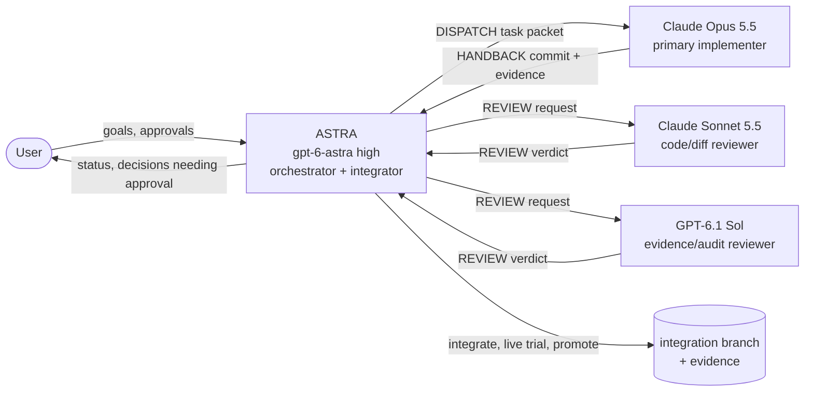

# Multi-agent collaboration hub

Start here if you are any agent (Claude, Codex/ASTRA, Sol, Grok) or a person
picking up work on this repository. This folder holds the **live coordination
state**: who owns what, what is being worked on, and what each agent said.
Engineering detail stays in the existing docs. This folder links to them
instead of copying them.

| Read | When |
| --- | --- |
| [BOARD.md](BOARD.md) | First, every session: what is ready, in progress, in review, blocked |
| [SESSION_LINKS.md](SESSION_LINKS.md) | Identify the user's linked Claude Desktop and Codex conversations and open the shared work logs |
| [Open Knowledge index](../knowledge/index.md) | Find compact context for the assigned task; load only relevant concepts and canonical sources |
| [Knowledge workflow](../OPEN_KNOWLEDGE.md) | Maintain source links, detect drift, search and export shared context |
| [PROTOCOL.md](PROTOCOL.md) | Before taking or dispatching any task: roles, authority, message format, limits |
| [GIT_WORKFLOW.md](GIT_WORKFLOW.md) | Before branching, committing, reviewing or integrating |
| [COMPETITION_CONTEXT.md](COMPETITION_CONTEXT.md) | Before proposing architecture or optimization work: what top 2026 IGVC teams did and how it maps to this repository |
| [DECISIONS.md](DECISIONS.md) | Before reopening a settled question |
| [tasks/](tasks/) | The task you were assigned, including its full message log |
| [templates/](templates/) | Creating a task or writing a review |
| [SENDOFF_ASTRA.md](SENDOFF_ASTRA.md) | The kickoff prompt that started live orchestration (2026-10-04) |
| [OBSERVATORY.md](OBSERVATORY.md) | Read-only visualizer integration, exported events, identity and freshness limits |

Project rules still come first: [AGENTS.md](../../AGENTS.md),
[CLAUDE.md](../../CLAUDE.md), [README.md](../../README.md) and the
[current handoff](../CLAUDE_HANDOFF.md). If this folder conflicts with them,
those files win. Record the conflict as a `DECISION` request in the task log.

## The team

- **ASTRA** decides what gets worked on, keeps the board current, holds the
  live-simulator lease, owns shared interfaces and Unity builds, and is the
  only role that integrates, promotes or rejects work.
- **Opus** does most implementation and analysis on its own branch and
  worktree. A second Opus or a Sonnet implementer can run in parallel only on
  a disjoint task (at most two implementers in total).
- **Sonnet** reviews code: correctness, invariants, test quality, scope.
- **Sol** reviews evidence: whether the acceptance claim is supported. It
  looks at provenance, audit results, comparability with the baseline and
  health. Because it comes from a different vendor, its mistakes are less
  likely to overlap with those of the Claude author.

[PROTOCOL.md](PROTOCOL.md#roles-and-authority) has the full authority matrix.

## The loop in one screen

1. ASTRA picks the top item from the [board](BOARD.md) and writes a task file from
   [the template](templates/TASK.md): hypothesis, owned files, baseline,
   tests and stop condition. The status becomes `ready`.
2. ASTRA appends a `DISPATCH` message and launches the implementer
   (see [dispatch commands](PROTOCOL.md#dispatch-commands)).
3. The implementer appends `ACK`, works on its branch, and asks through
   `QUESTION` or `LEASE-REQUEST` entries. It finishes with a `HANDBACK`
   message and the status becomes `review`.
4. ASTRA requests one review pass from Sonnet and one from Sol, which can run in
   parallel. Each reviewer appends a `REVIEW` message with a verdict.
5. ASTRA appends a `DECISION` message (accept, request changes or reject),
   integrates accepted commits, runs combined checks and any live trial, and
   updates the [handoff](../CLAUDE_HANDOFF.md) if the baseline changed.
6. `wsl -d Ubuntu-24.04 -- python3 tools/agents/board.py` regenerates the board
   (`--check` only validates). Commit coordination changes separately from code.

## Rules that matter most

- **One owner per file.** The task file lists owned paths, and nobody else edits them.
- **One live simulator at a time** for each instance. Check the lease before you run anything.
  A finished sandbox lap can still own the bridge.
- **Evidence over claims.** 6/6 progress is not an audit pass. A result that
  cannot be reproduced from recorded hashes and profile does not count.
- **No hidden course knowledge** in autonomy. WORLD geometry is for audit and rendering only.
- **No silent model substitution, no automatic retries** after auth, quota or model errors.
- **No push, publish, reset, clean or blind `git add -A`** without user approval.
